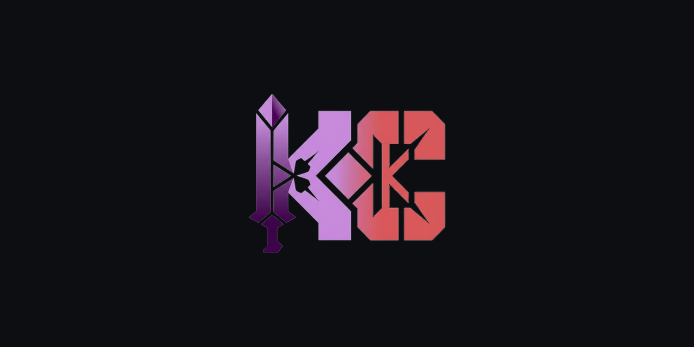

<a id="top"></a>

<div align="center">



<h1>TieBreaker</h1>

<p><strong>Un juez para decisiones difíciles: las opciones entran como matriz, el veredicto sale con razones.</strong></p>

<p>
  
  
  
  <a href="https://github.com/KapsCa/TieBreaker/releases"></a>
</p>

<p>
<a href="#que-hace"><strong>Qué hace</strong></a> &bull;
<a href="#funciones"><strong>Funciones</strong></a> &bull;
<a href="#stack"><strong>Stack</strong></a> &bull;
<a href="#desarrollo"><strong>Desarrollo</strong></a> &bull;
<a href="#estado"><strong>Estado</strong></a>
</p>

</div>

---

<p>
Decidir entre dos opciones parecidas es un problema de estructura, no de intuición. TieBreaker obliga a
poner los criterios por escrito, los pesa, y devuelve un veredicto con el razonamiento a la vista — para
discutirlo, no para obedecerlo.
</p>

## Qué hace

- Carga una decisión con sus opciones y criterios, con pesos ajustables.
- Compara con matriz de pros y contras, y con matriz SWOT cuando la decisión lo amerita.
- Simula pesos alternativos para ver cuándo cambia el resultado.
- Abre un "abogado del diablo" que ataca la opción elegida antes de que lo haga alguien más.
- Exporta el análisis y guarda historial de decisiones en el navegador.

## Funciones

| Vista | Para qué |
|---|---|
| `DecisionForm` | carga inicial: opciones, criterios y pesos |
| `ComparisonMatrixView` | comparación lado a lado con el peso de cada criterio |
| `ProsConsView` / `SwotMatrixView` | análisis cualitativo estructurado |
| `WeightSimulatorView` | sensibilidad: qué pasa si cambian las prioridades |
| `DevilsAdvocateView` | contraargumentos generados contra la opción ganadora |
| `VerdictView` | veredicto con justificación |
| `WhatIfChatModal` | preguntas puntuales sobre el análisis |
| `HistoryModal` / `ExportModal` | historial local y exportación |

## Stack

| Pieza | Elección |
|---|---|
| UI | React `19` + TypeScript, Vite |
| Estilos | Tailwind CSS `4` |
| Modelo | `@google/genai` sobre un proxy propio (`server.ts`, Express) |
| Movimiento | `motion` |
| Persistencia | almacenamiento local del navegador |
| Ejecución | `tsx` en desarrollo, `esbuild` para el servidor |

## Desarrollo

```bash
npm install
cp .env.example .env    # API key del proveedor
npm run dev             # cliente + servidor
```

```bash
npm run build && npm start
npm run lint            # tsc --noEmit
```

## Estado

Prototipo funcional desarrollado durante el curso de creación de apps con IA de Google. La prioridad es
que el razonamiento sea explícito y exportable.
